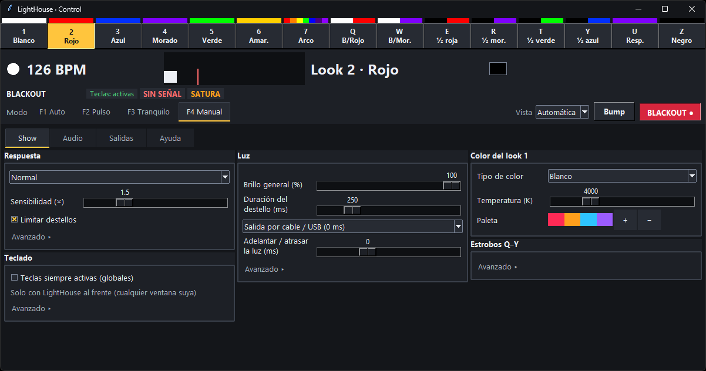
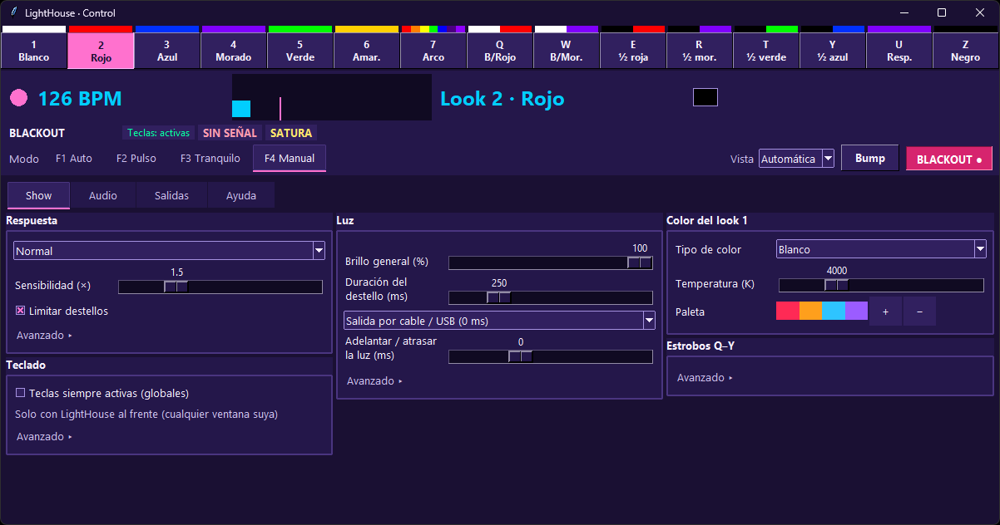
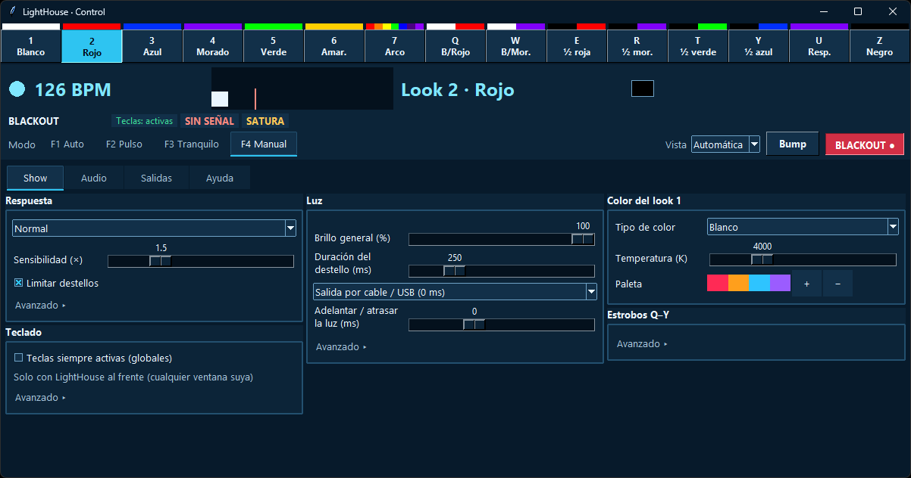
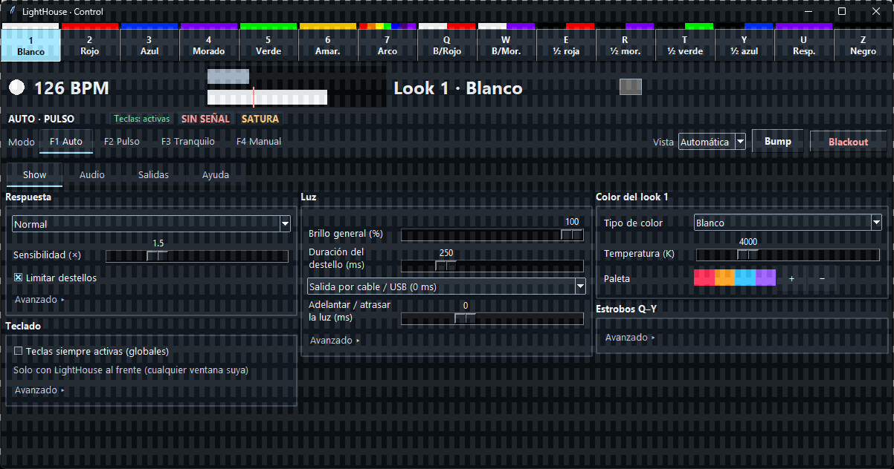
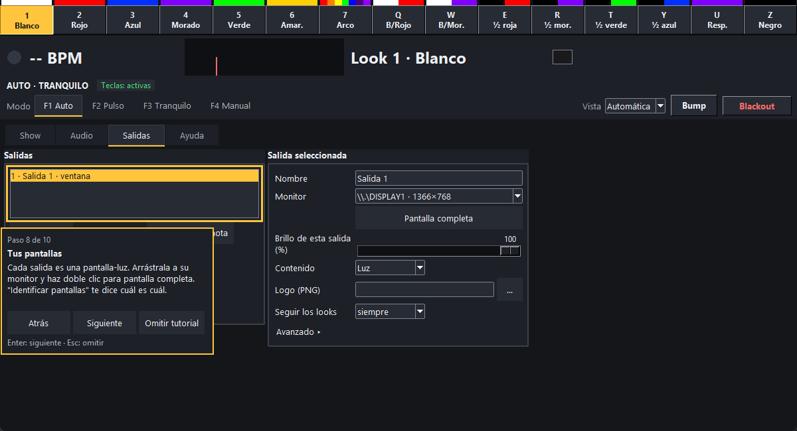
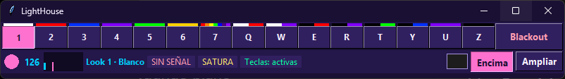
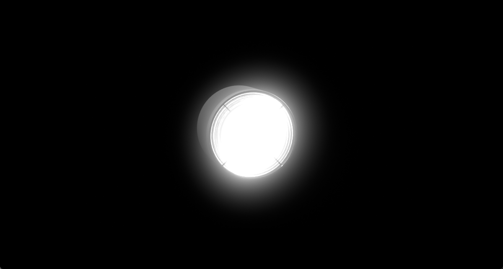
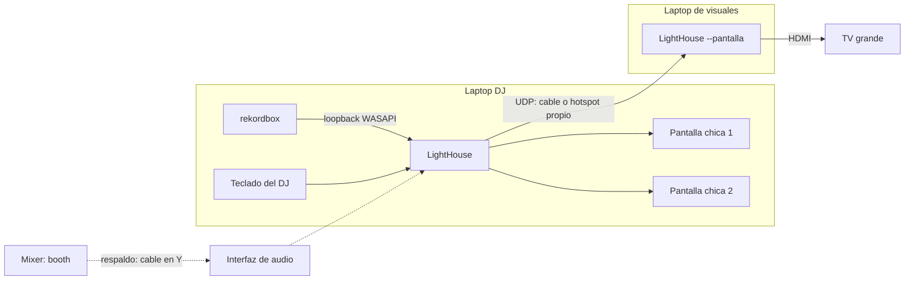
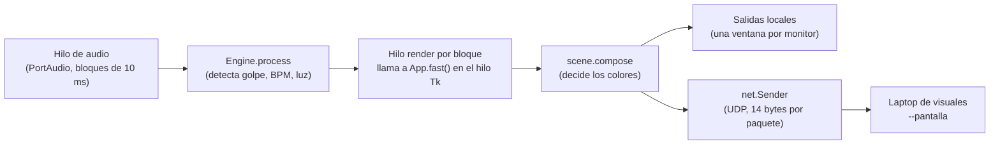

<div align="center">

# LightHouse

**Convierte cada golpe de bombo de tu set en luz, a pantalla completa.**

Aplicación de escritorio para Windows (Python / Tkinter) · versión 1.1.0



</div>

---

## Qué es y para quién

LightHouse escucha el audio de un set de DJ y vuelve cada golpe (kick) en luz sobre una o varias pantallas: monitores chicos, una TV grande o ambos. Está pensada para el DJ que toca en vivo, dispara los looks él mismo con el teclado y necesita que los visuales respondan al instante sin competir por recursos con rekordbox.

- **Escucha sin cables extra.** Toma el audio por loopback de la salida que ya usa rekordbox, o desde una interfaz de audio como respaldo.
- **Ligera.** Corre con prioridad de proceso baja para que rekordbox siempre gane. Con loopback consume entre 3 y 9 % de CPU en las mediciones del proyecto (ver [Arquitectura](#arquitectura-en-breve)).
- **Se maneja con el teclado.** 15 looks a una tecla de distancia, más Blackout y Bump.
- **Reparte la luz.** Varias salidas por monitor y una pantalla remota por red para la TV de otra laptop.

## Características

- **15 looks por teclado**: colores sólidos, arcoíris por golpe, estrobos, pantalla partida, un morado que respira y negro total.
- **Blackout y Bump**: apagar todo con una tecla y un destello a 100 % mientras se mantiene presionada otra.
- **Hasta 4 salidas de video**, cada una con su monitor, su brillo, su logo PNG y su regla para seguir (o no) los looks.
- **Pantalla remota por red**: una segunda laptop muestra la TV grande por HDMI; si se cae la red, la TV conserva el logo.
- **Cuatro modos de ventana según su tamaño**: completo, medio, compacto y **Mini**, una tira que se queda encima de rekordbox.
- **Ayudas al pasar el ratón** en todos los controles y un **tutorial interactivo** omisible.
- **Intro animada** de la lente (renderizada con Blender), que se puede desactivar.
- **Cuatro temas** de la ventana de control: Oscuro, Vaporwave, Glass (translúcido) y Blue Ocean.
- **Limitador de destellos** activo por defecto (máximo 6 por segundo) como protección para personas fotosensibles.
- **Ejecutable portable**: un ZIP que no requiere instalar Python.

## Capturas

| Tema Vaporwave | Tema Blue Ocean |
|:---:|:---:|
|  |  |

| Tema Glass (translúcido) | Tutorial interactivo |
|:---:|:---:|
|  |  |

| Modo Mini junto a rekordbox | Intro: el primer golpe |
|:---:|:---:|
|  |  |

El detalle de la interfaz (modos por tamaño, tooltips, tutorial y temas) está en [`fases/diseno-ui.md`](fases/diseno-ui.md).

## Descarga y uso rápido

> No necesitas instalar nada.

1. **Obtén el ZIP portable** `LightHouse-<versión>-win64.zip` (por ejemplo `LightHouse-1.1.0-win64.zip`). Se genera con `.\build.ps1` y queda en `dist\` (ver [Desarrollo](#desarrollo)).
2. **Desbloquéalo antes de descomprimir**: clic derecho al ZIP, Propiedades, marca "Desbloquear" y Aceptar. Después extrae la carpeta completa.
3. Abre `LightHouse.exe`. Si Windows muestra **SmartScreen**, elige "Más información" y luego "Ejecutar de todas formas": es normal, el programa no está firmado.
4. En la pestaña **Audio**, en "Fuente de audio", elige `Salida (loopback) · <dispositivo que usa rekordbox>`, el mismo que configuraste en rekordbox (Preferencias, Audio).
5. Pon música y confirma que el medidor de la franja "En vivo" se mueve.

La primera vez, LightHouse te ofrece un recorrido de 2 minutos (puedes decir "Ahora no" y repetirlo desde Ayuda, "Ver tutorial"). La guía completa para el usuario final, con el montaje, los avisos y el checklist de show, está en [`LEEME.txt`](LEEME.txt).

Para usar una interfaz de audio en lugar del loopback, o el micrófono, se necesita activar el permiso de micrófono de Windows para aplicaciones de escritorio (detalle en `LEEME.txt`).

## Teclas

Las teclas funcionan con LightHouse al frente (la ventana de control o cualquiera de las salidas), salvo mientras escribes en un campo de texto, y nunca con Ctrl o Alt presionados. Cada look queda activo hasta que eliges otro. Al abrir, siempre arranca en el look 1. Las teclas y colores se pueden cambiar en `config.json` (llaves `keys` y `look_colors`).

### Looks

| Tecla | Look |
|:---:|---|
| `1` | Blanco (o el "Color del look 1") |
| `2` | Rojo |
| `3` | Azul |
| `4` | Morado |
| `5` | Verde |
| `6` | Amarillo |
| `7` | Arcoíris: un color por golpe |
| `Q` | Estrobo blanco / rojo |
| `W` | Estrobo blanco / morado |
| `E` | Pantalla partida: negro / rojo |
| `R` | Pantalla partida: negro / morado |
| `T` | Pantalla partida: negro / verde |
| `Y` | Pantalla partida: negro / azul |
| `U` | Morado que sube 4 s y baja 4 s |
| `Z` | Negro total (ignora la música) |

`1` a `7` también funcionan con el teclado numérico. En los estrobos (`Q` a `Y`) el color prende a tope en cada golpe y se apaga cuando el golpe deja de sonar, con negro real entre golpes; en `E` a `Y` los lados se intercambian en cada golpe.

### Control del show

| Tecla | Acción |
|:---:|---|
| `Espacio` | Blackout: apaga todo; otra vez para volver |
| `F` (mantener) | Bump: color del look sólido al 100 % (en `Z`, blanco); al soltar, todo sigue como estaba |
| `F1` `F2` `F3` `F4` | Modo Auto / Pulso / Tranquilo / Manual |
| `0` (o `0` del numérico) | Marcar el ritmo: toca al ritmo 3 o más veces |
| `+` / `-` (también los del numérico) | Sensibilidad más / menos 0.1 (de 1.0 a 3.0) |
| `F9` | Vista Mini / volver a la ventana grande |

El botón **Bump** de la franja "En vivo" hace lo mismo que `F` mientras lo mantienes presionado. En la salida, doble clic alterna pantalla completa y `Esc` vuelve a ventana. La lista completa también está en la pestaña Ayuda, "Atajos".

## Montaje típico

La laptop DJ corre rekordbox y LightHouse, y maneja dos pantallas chicas. Por red (cable Ethernet directo o hotspot propio, nunca el Wi-Fi del lugar) manda lo que debe mostrar la TV a una segunda laptop que corre LightHouse en modo `--pantalla` y la muestra por HDMI.



- **Respaldo de audio**: si el loopback no funciona (por ejemplo, porque rekordbox usa ASIO), conecta el booth con un cable en Y a una entrada de la interfaz de audio, con +48V apagado y la ganancia baja. En la pestaña Audio elige `Entrada · <interfaz>` y el canal correspondiente. Con nivel "Fijo", la perilla de booth del mezclador funciona como sensibilidad.
- **Solo hay una laptop**: la pantalla remota no es obligatoria; las salidas locales funcionan por sí solas.
- **Firewall**: la primera vez, Windows pregunta en la laptop de visuales; permite el acceso en redes **privadas**. El puerto por defecto es UDP 47800.
- **Tras desconectar la red**, el envío se recupera solo en menos de 5 s.

Los pasos exactos (agregar la TV remota, el acceso directo con `--pantalla`, el checklist de show) están en las secciones 3, 4, 6 y 8 de [`LEEME.txt`](LEEME.txt).

## Desarrollo

### Requisitos

- Windows (usa WASAPI y la API de Windows con `ctypes`).
- **Python 3.14** (con el que se desarrolla y se construye el ejecutable), con `tkinter` incluido.
- Dependencias de ejecución en [`requirements.txt`](requirements.txt): `numpy` y `PyAudioWPatch`.
- Para construir el ejecutable, además [`requirements-build.txt`](requirements-build.txt): `pyinstaller`.
- Opcional, solo para regenerar la intro: Blender 5.2 o superior.

### Comandos

Instalar las dependencias:

```powershell
python -m pip install -r requirements.txt
```

Correr la aplicación (con intro o sin ella):

```powershell
python -m lighthouse
python -m lighthouse --sin-intro
```

Correr las verificaciones automáticas (motor con señal sintética, interfaz sin ventana, temas, red e intro; sale con código 0 si todo pasa, 1 si falla):

```powershell
python -m lighthouse --test
```

Correr el modo receptor de la TV remota:

```powershell
python -m lighthouse --pantalla
python -m lighthouse --pantalla --puerto 47800 --monitor 2 --logo "C:\logo.png"
```

Construir el ejecutable y el ZIP portable (crea un entorno `.venv-build`, instala las dependencias, corre `--test`, empaqueta con PyInstaller y valida el `.exe`):

```powershell
.\build.ps1
```

Regenerar la intro con Blender (ver [`tools/intro/LEEME.md`](tools/intro/LEEME.md)); la segunda forma reutiliza los pases ya renderizados y tarda segundos:

```powershell
.\tools\intro\generar.ps1 -Concepto C-primer-golpe
.\tools\intro\generar.ps1 -Concepto C-primer-golpe -ReusarCapas
```

### Argumentos de línea de comandos

| Argumento | Efecto |
|---|---|
| `--test` | Verificaciones automáticas (motor, interfaz, temas, red e intro); termina con código 0 o 1 |
| `--sin-intro` | Abre sin la animación de entrada |
| `--pantalla` | Modo receptor de la TV remota (sin audio, sin intro ni tutorial) |
| `--puerto N` | Con `--pantalla`: puerto UDP (por defecto 47800) |
| `--monitor N` | Con `--pantalla`: monitor donde se abre (1, 2, 3... = `DISPLAYn`; por defecto el externo, si no el principal) |
| `--logo ruta.png` | Con `--pantalla`: logo que se muestra sin señal (archivo de esa laptop) |

Los valores de `--pantalla` se recuerdan en `config.json` (llave `pantalla`); la siguiente vez basta con abrirlo.

## Arquitectura en breve

Un solo proceso, sin multiproceso ni bus de eventos. El análisis se hace una vez, en la laptop DJ, y todas las pantallas comparten exactamente el mismo estado.



Números medidos en este proyecto (ver [`fases/README.md`](fases/README.md)):

| Dato | Valor |
|---|---|
| `Engine.process` por bloque de audio | 42 µs |
| Pintado de una salida a pantalla completa (1920×1080) | 0,3 ms |
| Salto del audio al pintado (hilo `render`) | mediana 0,2 ms, p99 ~1 ms |
| Latencia total de punta a punta | ~65 a 120 ms hoy; objetivo ~50 a 70 ms con Modo Juego en las TV (estimación del diseño) |
| CPU con loopback (completa / Mini) | 4,6 % / 3,2 % (medido en F9); 6 a 9 % en las primeras fases |
| Ejecutable (`dist\LightHouse`) | 57,8 MB (ZIP de 24,3 MB) |

La latencia de las TV depende de la TV: sin Modo Juego puede llegar a 30 a 120 ms, así que cada salida tiene su propio retardo extra y el offset general va de -150 a +300 ms. El CPU varía entre máquinas y sesiones (las mediciones del proyecto tienen ruido de unos puntos porcentuales).

## Estructura del repo

| Ruta | Contenido |
|---|---|
| `lighthouse/` | Paquete de la aplicación (módulos abajo) |
| `assets/` | Ícono y recursos de la intro (`assets/intro/`) |
| `tools/intro/` | Generador de la intro con Blender (no entra al ejecutable) |
| `fases/` | Plan de desarrollo por fases y especificación de la interfaz |
| `docs/capturas/` | Capturas usadas en este README |
| `run.py` | Punto de entrada del ejecutable |
| `build.ps1`, `lighthouse.spec` | Construcción del ejecutable portable con PyInstaller |
| `requirements.txt`, `requirements-build.txt` | Dependencias de ejecución y de construcción |
| `LEEME.txt` | Guía para el usuario final (se incluye en el ZIP) |
| `PLAN.md` | Diseño original de la maqueta; ver [`PLAN.md`](PLAN.md) |

Módulos de `lighthouse/`:

| Módulo | Qué hace |
|---|---|
| `__main__.py` | Arranque, registro de errores y argumentos de línea de comandos |
| `audio.py` | Captura WASAPI: entradas, loopback, canal y estado de la señal |
| `engine.py` | Motor DSP puro: golpe, BPM, calma, tempo y nivel de luz |
| `scene.py` | Los 15 looks y `compose()`, la única función que decide colores |
| `outputs.py` | Salidas de video: una ventana por monitor y la salida remota |
| `net.py` | Emisor y receptor UDP de la pantalla remota |
| `pantalla.py` | Modo receptor `--pantalla` para la laptop de la TV |
| `ui.py` | Ventana de control, teclas, presets y calibración |
| `layout.py` | Layout responsive: modo y reparto de tarjetas según el tamaño |
| `theme.py` | Tokens de apariencia y los cuatro temas |
| `tips.py` | Catálogo de ayudas al pasar el ratón y su ventana |
| `tutorial.py` | Tutorial interactivo omisible |
| `intro.py` | Reproductor de la animación de entrada a partir de un manifiesto JSON |
| `config.py` | Configuración persistente en JSON con escritura atómica |
| `win32.py` | Todo el acceso a la API de Windows (`ctypes`) |
| `selftest.py` | Verificaciones que ejecuta `--test` |

## Configuración y registros

| Qué | Dónde |
|---|---|
| Configuración | `%APPDATA%\LightHouse\config.json` |
| Registros (logs) | `%LOCALAPPDATA%\LightHouse\logs` (archivo `lighthouse.log`) |

Ambas rutas se muestran en la pestaña Ayuda, que además tiene un botón para abrir la carpeta de registros. Si algo falla, comparte el archivo `lighthouse.log`.

## Plan de desarrollo

El plan completo, con decisiones, mediciones y pendientes de cada fase, está en [`fases/README.md`](fases/README.md).

| Fase | Tema |
|---|---|
| F1 | Base modular: paquete, configuración persistente y `--test` |
| F2 | Entrada de audio, latencia y prioridad baja |
| F3 | Ejecutable portable con PyInstaller |
| F4 | Looks por teclado, compuerta de golpe y limitador de destellos |
| F5 | Salidas múltiples y pantalla completa |
| F6 | Pantalla remota por red (TV grande) |
| F7 | Tokens de diseño, tema por defecto y registro de controles |
| F8 | Arquitectura de información y layout responsive |
| F9 | Modo Mini, siempre encima y tecla `F9` |
| F10 | Ayudas al pasar el ratón en todos los controles |
| F11 | Tutorial interactivo omisible |
| F12 | Propuestas de intro con Blender (elegida: "Primer golpe") |
| F13 | Implementación de la intro elegida |
| F14 | Temas: Oscuro, Vaporwave, Glass y Blue Ocean |

## Aviso de seguridad

Los destellos rápidos pueden afectar a personas con epilepsia fotosensible. Avisa a los asistentes. El límite de destellos viene activo por defecto; desactívalo solo a conciencia.

## Autor y derechos

Michael Rodríguez Reséndiz

© 2026 Michael Rodríguez Reséndiz. Todos los derechos reservados.
